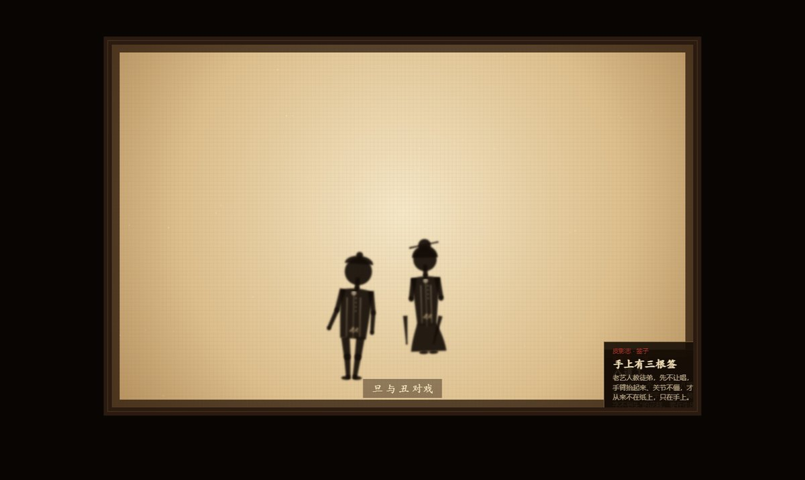
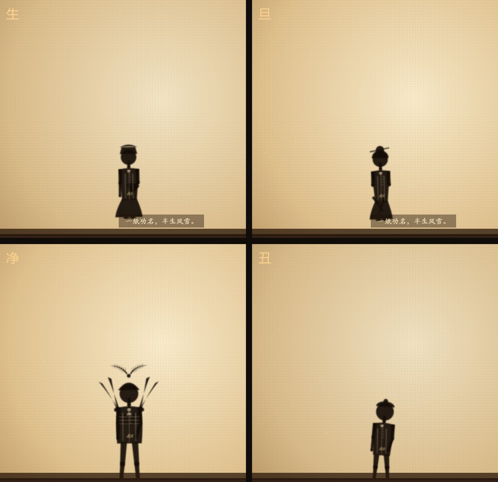
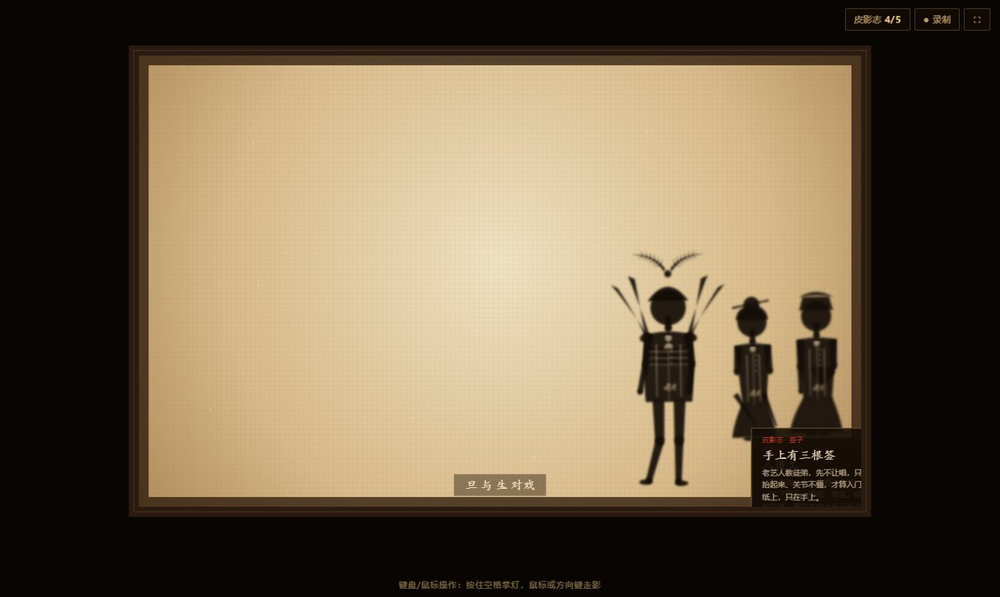
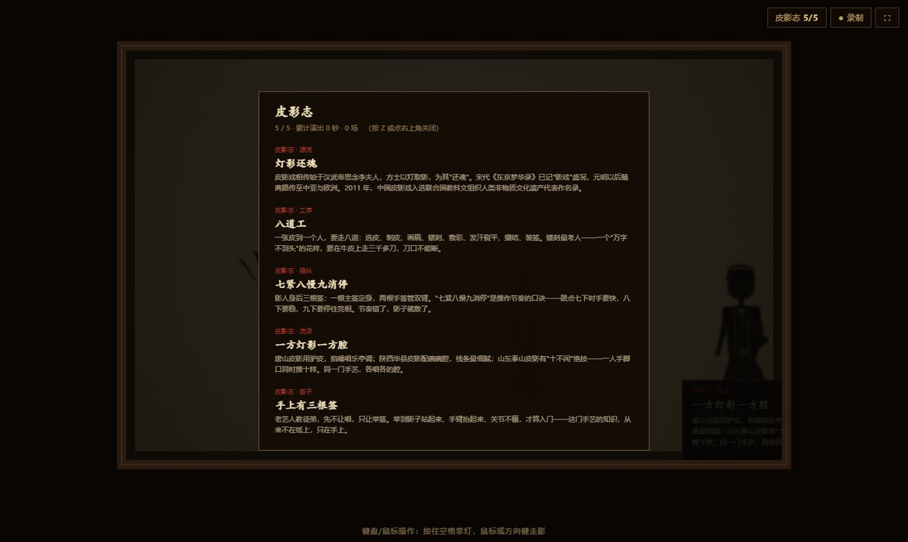

# 掌灯 · 手势皮影戏

> 你不必看皮影 —— 你来演皮影。

一件用手势驱动的**皮影戏交互装置**。摄像头读出你的手，幕布上的影人随之行走、亮相、对戏。
全程本地运行、离线推理，不联网、不依赖任何在线服务。

## ▶ 在线体验

**https://neon-liyi.github.io/zhangdeng/** —— 用 Chrome / Edge 打开即可（手机也能玩：横屏更好）。
没有摄像头也可以：入场时选「键盘 · 鼠标操作」，或用「无摄像头 · 看演示」看一轮完整演出。



---

## 它是什么

皮影艺人操纵影人靠三根签：一根主签定身，两根手签管双臂。什么时候紧、什么时候慢、什么时候停住亮相，
全凭一句口诀 —— **七紧八慢九消停**。这些知识从不写在纸上，只活在人的身体里。

这个作品把计算机视觉当作那根签：**机器不是替代手艺人，而是让没学过皮影的人第一次拥有"操纵影人"的身体经验。**

---

## 怎么玩

### 摄像头模式（主玩法）

| 手势 | 影人动作 |
|---|---|
| 张开手掌 | 灯亮、幕布亮起、影人登场 |
| 手掌左右移动 | 影人行走（手越快，步频越快） |
| 手掌上抬 / 下压 | 影人靠近灯 → 影子变大、边缘变虚；上挑则腾跃 |
| 拇指+食指捏合 | 拱手作揖、亮相定住 |
| 握拳 | 换行当（生 → 旦 → 净 → 丑） |
| 双手入画 | 第二个影人登场，与主角不同行当 |
| 两手靠近 | 触发对戏 |
| 手移出画面 | 灯渐暗、落朱红印章、戏散 |

### 键盘 / 鼠标模式（没有摄像头也能完整演出）

`空格`起灯 · `←→`走影 · `↑↓`控制离灯远近 · `E`挑签亮相 · `Q`换行当 · `1–4`指定行当 ·
`T`加一位影人（最多四人同台）· `G`对戏 · `Z`查阅皮影志 · `Esc`收灯。鼠标移动即走影。

### 无摄像头演示模式

自动跑一轮完整演出，适合评委预览与循环展示。

---

## 作品内容

**四个行当**（各是一套独立骨骼与道具，不是换贴图）

| 行当 | 造型 |
|---|---|
| 生（文生） | 方巾长袍、手持折扇，行走靠下摆的"飘" |
| 旦（青衣） | 水袖是给影子加的风，袖越长影越飘 |
| 净（花脸） | 靠旗四面、翎子两根带羽枝，只站着就有"势" |
| 丑（小丑） | 短打露腿、矮身碎步，靠一记踉跄拿住满台的笑 |



**五折原创台本**：刀会（武戏）· 拾镯（做工）· 磨刀（滑稽）· 拜师（学戏）· 灯影还魂（大戏）。
每幕由指定手势推进，台词与幕序均为原创撰写。

**点板引擎「七紧八慢九消停」**：把老艺人的节奏口诀做成可玩判定 —— 在鼓点附近出手算"对板"，
影人使个漂亮身段；出手偏了，影子会抖、会散。

**文场（原创配乐）**：板胡、月琴、大阮、板鼓四样乐器**全部现场合成**，用原创五声调式，
不引用任何现成唱腔或乐曲录音。

**四种布景氛围**：灯 / 火 / 月 / 暮，各自改换幕布底色与粒子（浮尘 / 火星 / 雾气 / 落叶）。
远山、主景片、近景与影人同属"影子"，只是更淡、更远。



**皮影志（非遗知识层）**：五条知识**只有做出对应动作才解锁** —— 起灯得"灯影还魂"、
换角得"八道工"、挑签得"七紧八慢九消停"、对戏得"手上有三根签"、连演 26 秒得"一方灯影一方腔"。
进度存本地，随时可翻看。



**其他**：演出可一键录制成 webm（含实时合成的锣鼓声）；支持四人同台；手机竖屏自适应。


---

## 运行

需要 **Chrome / Edge**（用到 MediaPipe + Canvas + Web Audio）。

```
双击  启动掌灯.bat        → 浏览器自动打开 http://127.0.0.1:8124/
```

进入后可选「启灯·开摄像头」/「键盘·鼠标操作」/「无摄像头·看演示」。

想重选或退出这一轮：右上角「⌂ 首页」或按 **Home**（各面板底下也有「回首页」）——回到开场幕重新选，不用关程序。

### 关于 `vendor/` 与 `models/`

**本仓库是在线体验部署，已包含** MediaPipe Tasks Vision 运行时（`vendor/`，Apache-2.0）
与手部关键点模型（`models/hand_landmarker.task`）——所以打开网页就能跑，克隆下来双击
`启动掌灯.bat` 也能离线跑（需要本机有 Python，脚本会自动找一个可用的）。

如果只想留原创代码，删掉这两个目录不影响阅读；只是摄像头模式会起不来（键鼠与演示模式照常）。
它们分别是：

1. **MediaPipe Tasks Vision 运行时** —— `vendor/vision_bundle.js` + `vendor/wasm/`
2. **手部关键点模型** —— `models/hand_landmarker.task`（Google MediaPipe 官方 float16 版）

```
掌灯/
├── index.html          入口
├── app.js              主程序：舞台 / 导演 / 皮影志 / 录制 / 三种输入
├── hand.js             手势引擎：21 点特征解算 + 迟滞与指数平滑
├── puppet.js           影人：四个行当的骨骼、绘制与动画
├── scenery.js          布景：远山 / 景片 / 氛围粒子 / 灯光 mood
├── plays.js            戏折子：台本、台词、幕序
├── beat.js             点板引擎：七紧八慢九消停
├── music.js            文场：全合成的板胡 / 月琴 / 大阮 / 板鼓
├── vendor/             （需补）MediaPipe 运行时
└── models/             （需补）hand_landmarker.task
```

---

## 技术要点

- **手势解算**：MediaPipe HandLandmarker，21 关键点 → 掌心、各指伸张状态、捏合距离比、
  拇指-小指距离等特征；伸指判定用「指尖-腕 vs 指中节-腕」的比值，避免握拳被误判成张掌；
  捏合必须同时满足「拇指食指足够近」**且**「食指本身是伸开的」。进入/退出全做迟滞 + 指数平滑。
- **影子物理**：影人离灯越近，影子越大、边缘越虚（实时 blur），把手抬高即可看到。
- **影人**：两段式四肢 + 前向运动学，行走相位由手的水平速度推进；短腿行当补足腿长差，
  四个行当永远踩在同一条台面线上。
- **音画**：音效与配乐全部 WebAudio 实时合成，无音频素材。

---

## 原创性声明

- 影人造型、布景、界面排版**全部由代码原创绘制**，未使用任何第三方图像素材
- 全部音效与配乐由 WebAudio **实时合成**，未使用任何音频素材
- 五折台本、台词、皮影志条目文字均为原创撰写（史实与口诀部分取自公开非遗资料）

外部依赖仅 MediaPipe（Apache-2.0）与操作系统字体。

---

## 授权

代码用于学习与作品展示。如需商用或二次分发其中素材，请先联系作者。
